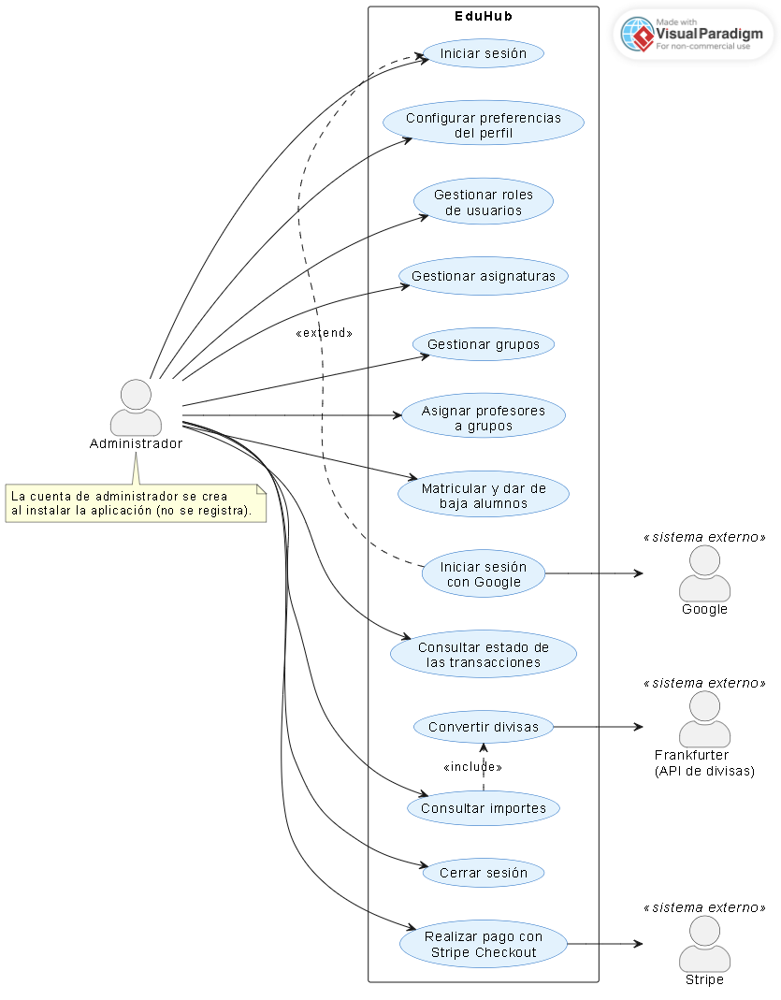
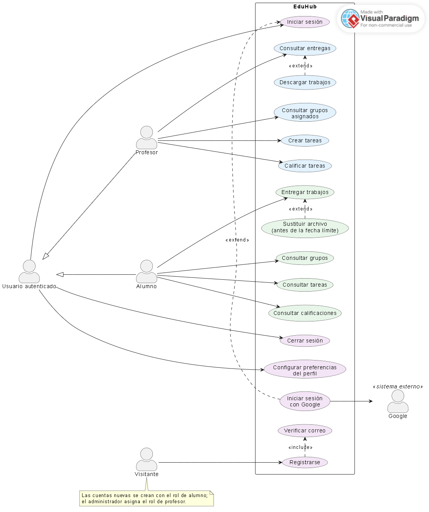
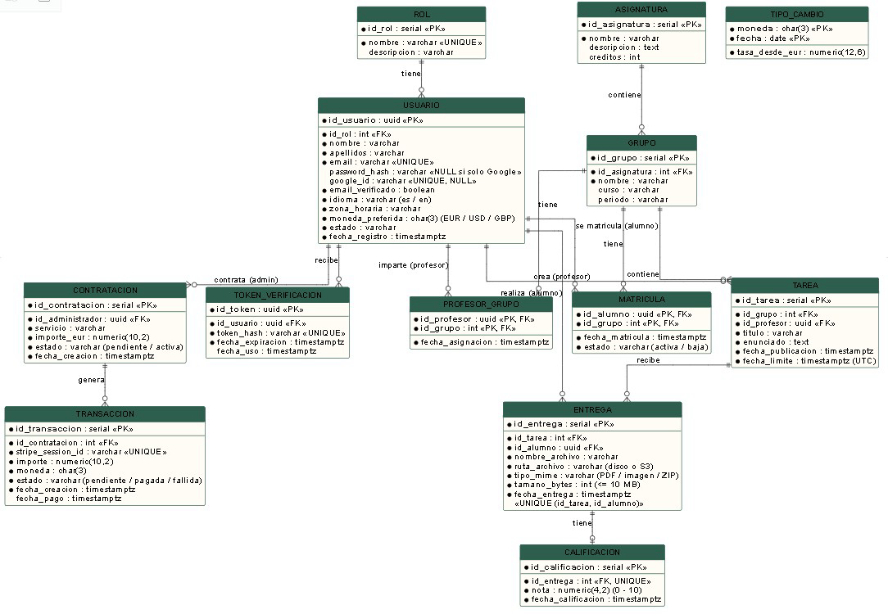
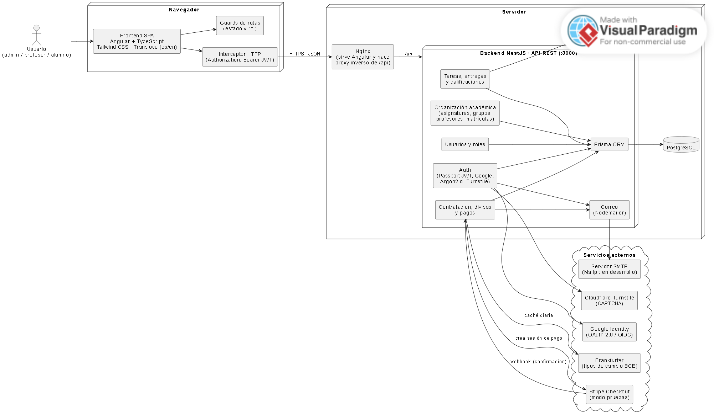
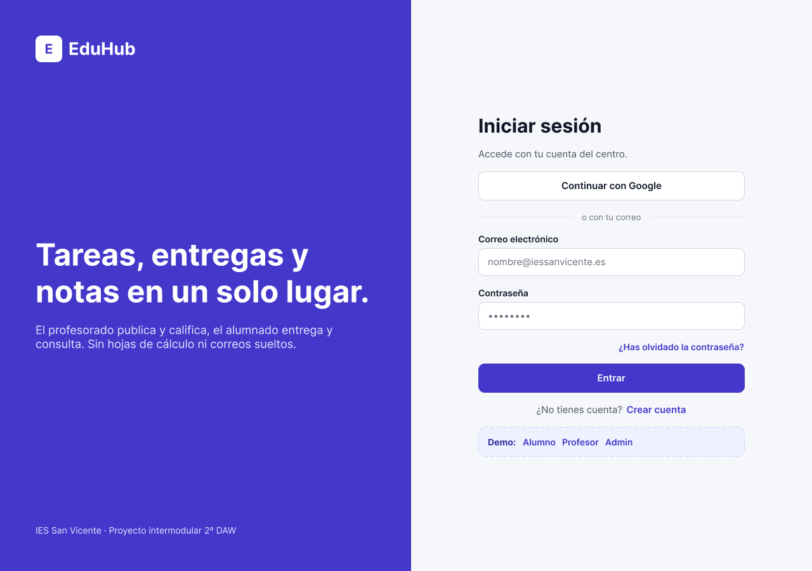
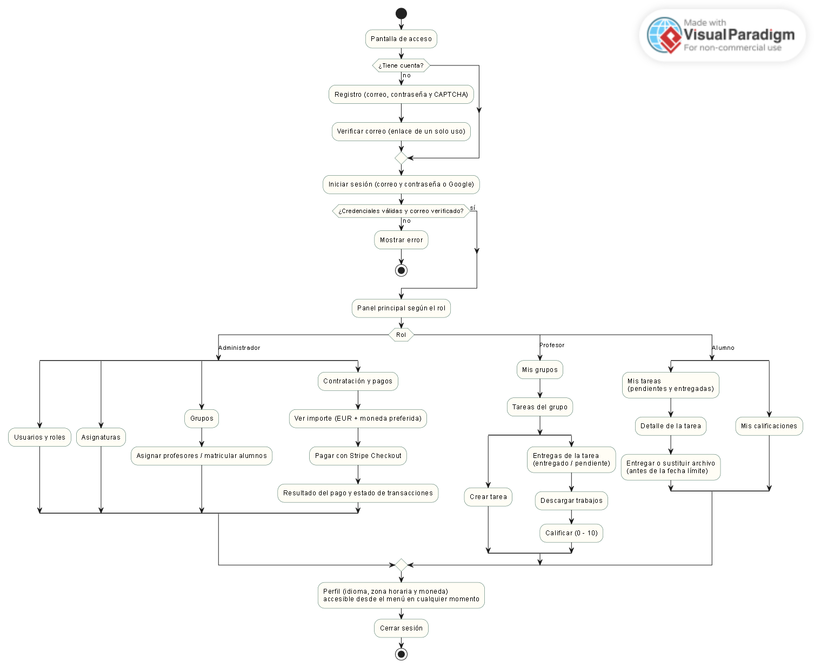

# Primeros apartados
## 1. Introducción

### 1.1 Objetivo del proyecto:

El objetivo principal de EduHub es desarrollar una aplicación web que centralice la gestión académica de un centro educativo. La plataforma permitirá administrar asignaturas y grupos, asignar profesores, matricular alumnos y gestionar tareas, entregas y calificaciones, ofreciendo a cada usuario las funcionalidades correspondientes a su rol.

Además, se busca desarrollar una aplicación segura, adaptable a diferentes dispositivos y disponible en español e inglés. El proyecto incluirá la integración de servicios externos, un sistema de contratación y pagos en modo de pruebas y el despliegue de la aplicación en diferentes infraestructuras. También se estudiará el uso de herramientas de inteligencia artificial y su posible incorporación como funcionalidad adicional.

### 1.2. Justificación del proyecto:

En los centros educativos, la gestión de tareas, entregas y calificaciones puede requerir el uso de diferentes herramientas digitales, lo que dificulta la organización y el seguimiento de las actividades académicas. EduHub surge con la intención de reunir estas funciones en una única plataforma, facilitando al profesorado la gestión de actividades, al alumnado la consulta de tareas y calificaciones y a los administradores la organización de asignaturas y grupos.

Además de su utilidad en el ámbito educativo, el desarrollo de EduHub permitirá aplicar los conocimientos adquiridos durante el ciclo de Desarrollo de Aplicaciones Web. El proyecto abarcará el desarrollo del frontend y del backend, la gestión de bases de datos, la implementación de medidas de seguridad y el despliegue en diferentes infraestructuras, ofreciendo una oportunidad para trabajar de forma conjunta las competencias adquiridas durante el ciclo.

### 1.3. Alcance del proyecto:

EduHub comprende el análisis, diseño, desarrollo, pruebas y despliegue de una aplicación web para la gestión académica de un centro educativo. Para organizar el trabajo, las funcionalidades se han dividido en tres niveles de prioridad: P1 (obligatorias), P2 (ampliaciones previstas) y P3 (funcionalidades futuras).

**Funcionalidades obligatorias (P1)**

La primera versión de EduHub incluirá cuatro módulos principales:

1.  **Gestión de usuarios y seguridad:** registro, verificación de correo, inicio de sesión mediante credenciales o Google y control de acceso según los roles de administrador, profesor y alumno.

2.  **Organización académica:** gestión de asignaturas y grupos, asignación de profesores y matriculación de alumnos.

3.  **Tareas, entregas y calificaciones:** publicación de actividades, entrega de archivos, seguimiento de trabajos y evaluación del alumnado.

4.  **Contratación y pagos:** integración de Stripe en modo de pruebas, consulta de tipos de cambio mediante una API externa y envío de confirmaciones por correo electrónico.

La aplicación se desarrollará utilizando Angular, NestJS y PostgreSQL, contará con una interfaz adaptable a diferentes dispositivos y estará disponible en español e inglés. También incluirá las medidas de seguridad, pruebas y documentación necesarias.

Además, se realizarán diferentes despliegues para comprobar su funcionamiento en servidores VPS, entornos híbridos y servicios en la nube, incluyendo arquitecturas PaaS y serverless.

**Ampliaciones previstas (P2)**

Una vez completada la primera versión, se podrán incorporar funcionalidades como la recuperación de contraseñas, la gestión avanzada de usuarios, los calendarios de entregas, las notificaciones automáticas, los exámenes online y las mejoras del sistema de pagos.

**Funcionalidades futuras (P3)**

Se contempla la posibilidad de ampliar EduHub para gestionar varios centros educativos, incorporar una biblioteca digital, permitir el acceso de las familias y añadir herramientas de gestión económica y de personal.

También se investigará el uso de inteligencia artificial y su posible integración mediante un generador de actividades o un asistente de dudas, siempre que el tiempo disponible lo permita.

**Limitaciones**

La primera versión estará destinada a un único centro educativo y funcionará exclusivamente como aplicación web. Los pagos se realizarán en modo de pruebas y se utilizarán datos ficticios para comprobar el funcionamiento del sistema. Las funcionalidades P2, P3 y la integración de inteligencia artificial no serán necesarias para considerar completada la entrega inicial.

### 1.4. Público objetivo

EduHub está dirigida a centros educativos que buscan centralizar la organización de sus actividades académicas. En su primera versión, la aplicación estará diseñada para un único centro y contará con tres tipos de usuarios:

- **Administradores:** encargados de gestionar las asignaturas, los grupos, los usuarios y sus roles, así como de acceder al módulo de contratación y pagos.

- **Profesores:** responsables de publicar tareas, establecer fechas de entrega, revisar los trabajos del alumnado y asignar calificaciones.

- **Alumnos:** podrán consultar sus asignaturas y actividades, entregar trabajos y acceder a las calificaciones obtenidas.

Cada usuario dispondrá de funcionalidades y permisos adaptados a su rol, facilitando el acceso a la información necesaria para realizar sus tareas dentro de la plataforma.

## 2. Antecedentes

### 2.1. Estado del arte

Actualmente, existen diferentes plataformas digitales que facilitan la gestión de actividades académicas, la entrega de trabajos y el seguimiento del alumnado. Entre las más conocidas se encuentran Moodle, Google Classroom y Microsoft Teams para Educación.

**Moodle** es una plataforma de gestión del aprendizaje (LMS) de código abierto que permite administrar cursos, publicar materiales, gestionar entregas y evaluar actividades. Destaca por sus posibilidades de personalización, aunque su configuración y mantenimiento pueden requerir conocimientos técnicos.

**Google Classroom** permite organizar clases, publicar tareas, establecer fechas de entrega y asignar calificaciones. Su principal ventaja es la sencillez de uso y su integración con herramientas como Google Drive y Documentos, aunque determinadas funciones de administración académica requieren soluciones complementarias.

**Microsoft Teams para Educación** combina la gestión de actividades académicas con herramientas de comunicación y colaboración. Permite compartir materiales, realizar reuniones virtuales y evaluar tareas, destacando por su integración con Microsoft 365.

**Relación con EduHub**

EduHub comparte con estas plataformas funcionalidades como la gestión de tareas, entregas y calificaciones, pero se centra en desarrollar una solución más reducida, orientada inicialmente a un único centro educativo. Además de las funciones académicas, el proyecto contempla la integración de servicios externos y el despliegue de la aplicación en diferentes infraestructuras, permitiendo aplicar y evaluar distintas tecnologías durante su desarrollo.

### 2.2. Problemática identificada

Aunque existen plataformas consolidadas como Moodle, Google Classroom y Microsoft Teams para Educación, estas ofrecen soluciones de carácter general que pueden incluir funcionalidades y opciones de configuración que excedan las necesidades de determinados centros educativos. En estos casos, puede resultar interesante disponer de una herramienta más acotada, cuya estructura y funcionalidades respondan directamente a las necesidades organizativas del centro.

El proyecto EduHub plantea el desarrollo de una aplicación web propia, orientada inicialmente a un único centro educativo, que integre en un mismo entorno la gestión de usuarios, asignaturas, grupos, actividades, entregas y calificaciones. La aplicación contará con diferentes roles y permisos para adaptar el acceso y las funcionalidades a las responsabilidades de administradores, profesores y alumnos.

### 2.3. Motivación

La elección de EduHub surge del interés por desarrollar una solución que permita centralizar la gestión académica de un centro educativo en una aplicación adaptada a sus necesidades organizativas. Frente a plataformas generalistas que ofrecen un amplio abanico de funcionalidades, proponemos desarrollar una herramienta más específica, con una estructura de usuarios, asignaturas, grupos y actividades ajustada al contexto de un único centro.

Asimismo, el proyecto nos permitirá explorar la integración de diferentes servicios externos y alternativas de despliegue, así como trabajar con tecnologías actuales como Angular, NestJS y PostgreSQL. Esto nos permitirá abordar el desarrollo de una solución completa y estudiar distintas posibilidades tecnológicas para su implementación.

## 3. Análisis

### 3.1. Requisitos funcionales

Los requisitos funcionales describen las operaciones que debe permitir realizar EduHub. Se han organizado en cuatro módulos, correspondientes a las funcionalidades obligatorias (P1) del proyecto.

**Módulo 1. Gestión de usuarios y seguridad**

| **ID** | **Requisito**            | **Descripción**                                                                                | **Prioridad** |
|--------|--------------------------|------------------------------------------------------------------------------------------------|---------------|
| RF01   | Registro de usuarios     | Permitir el registro mediante correo electrónico y contraseña, protegido con CAPTCHA.          | P1            |
| RF02   | Verificación de cuenta   | Verificar el correo electrónico mediante un enlace de un solo uso antes de permitir el acceso. | P1            |
| RF03   | Inicio de sesión         | Permitir el acceso mediante correo y contraseña o una cuenta de Google.                        | P1            |
| RF04   | Cierre de sesión         | Permitir cerrar la sesión del usuario.                                                         | P1            |
| RF05   | Gestión de roles         | Permitir al administrador asignar los roles de profesor y alumno.                              | P1            |
| RF06   | Control de acceso        | Restringir las funcionalidades según el estado de autenticación y el rol del usuario.          | P1            |
| RF07   | Configuración del perfil | Permitir configurar el idioma, la zona horaria y la moneda preferida.                          | P1            |

**Módulo 2. Organización académica**

| **ID** | **Requisito**            | **Descripción**                                                                       | **Prioridad** |
|--------|--------------------------|---------------------------------------------------------------------------------------|---------------|
| RF08   | Gestión de asignaturas   | Permitir al administrador crear, modificar y eliminar asignaturas.                    | P1            |
| RF09   | Gestión de grupos        | Permitir crear, modificar y eliminar grupos asociados a una asignatura.               | P1            |
| RF10   | Asignación de profesores | Permitir asignar o retirar uno o varios profesores de un grupo.                       | P1            |
| RF11   | Matriculación de alumnos | Permitir matricular y dar de baja a alumnos en los grupos.                            | P1            |
| RF12   | Consulta de grupos       | Permitir a profesores y alumnos consultar únicamente los grupos que tienen asignados. | P1            |

**Módulo 3. Tareas, entregas y calificaciones**

| **ID** | **Requisito**              | **Descripción**                                                                             | **Prioridad** |
|--------|----------------------------|---------------------------------------------------------------------------------------------|---------------|
| RF13   | Creación de tareas         | Permitir al profesor publicar tareas con título, enunciado y fecha límite.                  | P1            |
| RF14   | Consulta de tareas         | Permitir al alumnado consultar las tareas de sus grupos.                                    | P1            |
| RF15   | Entrega de trabajos        | Permitir subir archivos PDF, imágenes o ZIP de hasta 10 MB.                                 | P1            |
| RF16   | Modificación de entregas   | Permitir sustituir los archivos entregados antes de la fecha límite.                        | P1            |
| RF17   | Seguimiento de entregas    | Permitir al profesor consultar qué alumnos han entregado y cuáles tienen tareas pendientes. | P1            |
| RF18   | Descarga de trabajos       | Permitir al profesor descargar los archivos entregados por sus alumnos.                     | P1            |
| RF19   | Calificación de tareas     | Permitir al profesor asignar calificaciones numéricas entre 0 y 10.                         | P1            |
| RF20   | Consulta de calificaciones | Permitir al alumnado consultar las notas obtenidas y el estado de sus tareas.               | P1            |

**Módulo 4. Contratación, divisas y pagos**

| **ID** | **Requisito**             | **Descripción**                                                                                              | **Prioridad** |
|--------|---------------------------|--------------------------------------------------------------------------------------------------------------|---------------|
| RF21   | Consulta de importes      | Mostrar el importe del servicio o ampliación en euros.                                                       | P1            |
| RF22   | Conversión de divisas     | Consultar una API externa para mostrar importes equivalentes en USD o GBP.                                   | P1            |
| RF23   | Procesamiento de pagos    | Permitir al administrador realizar pagos mediante Stripe Checkout en modo de pruebas.                        | P1            |
| RF24   | Registro de transacciones | Registrar el estado de las operaciones y actualizar el estado de contratación tras la confirmación del pago. | P1            |
| RF25   | Confirmación por correo   | Enviar automáticamente un correo con el resumen del pago procesado.                                          | P1            |

**Requisitos funcionales transversales**

| **ID** | **Requisito**       | **Descripción**                                                              | **Prioridad** |
|--------|---------------------|------------------------------------------------------------------------------|---------------|
| RF26   | Cambio de idioma    | Permitir utilizar la aplicación en español e inglés.                         | P1            |
| RF27   | Adaptación regional | Mostrar fechas, horas, números y monedas según las preferencias del usuario. | P1            |

### 3.2. Requisitos no funcionales

| **ID** | **Categoría**        | **Requisito**             | **Descripción**                                                                                               | **Prioridad** |
|--------|----------------------|---------------------------|---------------------------------------------------------------------------------------------------------------|---------------|
| RNF01  | Seguridad            | Protección de contraseñas | Almacenar las contraseñas mediante el algoritmo Argon2id.                                                     | P1            |
| RNF02  | Seguridad            | Autenticación segura      | Utilizar tokens JWT con tiempo de expiración y controles de acceso en frontend y backend.                     | P1            |
| RNF03  | Seguridad            | Protección de datos       | Aplicar medidas de seguridad para evitar accesos no autorizados a la información académica.                   | P1            |
| RNF04  | Usabilidad           | Diseño responsive         | Adaptar la interfaz a ordenadores, tabletas y dispositivos móviles.                                           | P1            |
| RNF05  | Usabilidad           | Interfaz intuitiva        | Organizar la navegación según el rol del usuario, facilitando el acceso a sus funcionalidades.                | P1            |
| RNF06  | Internacionalización | Soporte multidioma        | Ofrecer la interfaz en español e inglés y adaptar fechas, horas y monedas.                                    | P1            |
| RNF07  | Compatibilidad       | Navegadores web           | Permitir el uso de la aplicación desde navegadores modernos.                                                  | P1            |
| RNF08  | Arquitectura         | Separación de componentes | Desarrollar el frontend con Angular, el backend con NestJS y la base de datos con PostgreSQL.                 | P1            |
| RNF09  | Arquitectura         | Comunicación REST         | Utilizar una API REST para la comunicación entre frontend y backend.                                          | P1            |
| RNF10  | Despliegue           | Portabilidad              | Permitir el despliegue de la aplicación en diferentes infraestructuras reutilizando una misma base de código. | P1            |
| RNF11  | Despliegue           | Reproducibilidad          | Documentar los pasos necesarios para instalar y configurar la aplicación en un servidor VPS.                  | P1            |
| RNF12  | Mantenimiento        | Calidad del código        | Utilizar control de versiones, una estructura modular y buenas prácticas de desarrollo.                       | P1            |
| RNF13  | Calidad              | Pruebas                   | Realizar pruebas unitarias y de integración para comprobar el funcionamiento de la aplicación.                | P1            |
| RNF14  | Sostenibilidad       | Uso eficiente de recursos | Aplicar medidas de optimización relacionadas con los ODS 9, 12 y 13.                                          | P1            |

### 3.3 Casos de uso

**Casos de uso del administrador**

El administrador se encarga de la organización académica de la plataforma. Puede gestionar usuarios, asignaturas y grupos, asignar profesores, matricular alumnos y realizar operaciones relacionadas con la contratación y los pagos.

**Casos de uso del profesor y del alumno**

El profesor puede consultar sus grupos, crear tareas, revisar las entregas y asignar calificaciones. Por su parte, el alumno puede consultar las tareas de sus grupos, entregar o sustituir trabajos antes de la fecha límite y consultar sus notas.

Ambos perfiles disponen también de funcionalidades comunes, como el registro, el inicio y cierre de sesión y la configuración de preferencias personales.

### 3.4. Descripción de actores

En EduHub se identifican tres tipos de usuarios, cada uno con funciones y permisos específicos dentro de la plataforma.

| **Actor**         | **Descripción**                                                                                                | **Funciones principales**                                                                                    |
|-------------------|----------------------------------------------------------------------------------------------------------------|--------------------------------------------------------------------------------------------------------------|
| **Administrador** | Responsable de la configuración y organización académica de la plataforma.                                     | Gestionar usuarios, asignaturas, grupos, matrículas, asignaciones de profesores y pagos.                     |
| **Profesor**      | Usuario encargado de gestionar las actividades académicas de los grupos que tiene asignados.                   | Crear tareas, consultar y descargar entregas, realizar el seguimiento del alumnado y asignar calificaciones. |
| **Alumno**        | Usuario matriculado en uno o varios grupos que utiliza la plataforma para realizar sus actividades académicas. | Consultar tareas, entregar trabajos, sustituir archivos antes de la fecha límite y consultar calificaciones. |

Los tres actores pueden iniciar y cerrar sesión, configurar sus preferencias personales y acceder únicamente a las funcionalidades correspondientes a su rol.

## 4.Diseño

En este apartado se describe la estructura técnica de EduHub, incluyendo la organización de la base de datos, la arquitectura de la aplicación y el diseño de la interfaz.

### 4.1. Modelo de datos

### 4.1. Diagrama entidad-relación (ER)
La base de datos de EduHub se diseñará utilizando PostgreSQL y permitirá almacenar y relacionar la información necesaria para el funcionamiento de la plataforma.

El siguiente diagrama entidad-relación representa las principales entidades del sistema, sus atributos, claves primarias y foráneas, así como las relaciones y cardinalidades existentes entre ellas.

**Figura 3. Diagrama entidad-relación de EduHub.**

El modelo contempla la gestión de usuarios y sus roles, la organización de asignaturas y grupos, las matrículas, las tareas y entregas del alumnado, las calificaciones y las operaciones relacionadas con la contratación y los pagos.

Esta estructura servirá como base para implementar la base de datos y garantizar la integridad de la información.

### 4.2. Arquitectura del sistema

EduHub seguirá una **arquitectura cliente-servidor**, con una separación entre la interfaz de usuario, la lógica de negocio y la base de datos.

La aplicación estará formada por tres componentes principales:

| **Componente**    | **Tecnología**          | **Función**                                                                          |
|-------------------|-------------------------|--------------------------------------------------------------------------------------|
| **Frontend**      | Angular y TypeScript    | Gestionar la interfaz y la interacción con los usuarios.                             |
| **Backend**       | NestJS                  | Procesar las solicitudes, gestionar la autenticación y aplicar la lógica de negocio. |
| **Base de datos** | PostgreSQL y Prisma ORM | Almacenar y gestionar la información de la plataforma.                               |

La comunicación entre el frontend y el backend se realizará mediante una **API REST**. Además, el backend se integrará con servicios externos como Google OAuth para el inicio de sesión, Cloudflare Turnstile para la protección del registro, Stripe para los pagos y Frankfurter para la conversión de divisas.

El sistema estará preparado para desplegarse en diferentes entornos, incluyendo servidores VPS, contenedores Docker y plataformas en la nube.

**Figura 4. Diagrama de arquitectura de EduHub.**

### 4.3. Prototipos de las pantallas

Los prototipos de EduHub permitirán visualizar el diseño inicial de la aplicación antes de comenzar su desarrollo. La interfaz se adaptará al tipo de usuario, ofreciendo diferentes opciones según su rol.

Se han identificado las siguientes pantallas principales:

| **Pantalla**                    | **Descripción**                                                                                               |
|---------------------------------|---------------------------------------------------------------------------------------------------------------|
| **Inicio de sesión y registro** | Permite acceder a la plataforma mediante correo electrónico y contraseña o Google, así como crear una cuenta. |
| **Panel principal**             | Muestra las funcionalidades disponibles según el rol del usuario.                                             |
| **Gestión académica**           | Permite al administrador gestionar asignaturas, grupos, profesores y matrículas.                              |
| **Gestión de tareas**           | Permite al profesor crear actividades, consultar entregas y asignar calificaciones.                           |
| **Mis tareas**                  | Permite al alumno consultar actividades, entregar archivos y visualizar sus notas.                            |
| **Contratación y pagos**        | Muestra los servicios disponibles, sus precios y las opciones de pago.                                        |
| **Perfil de usuario**           | Permite consultar y modificar las preferencias personales, como el idioma y la zona horaria.                  |

Los prototipos seguirán un diseño sencillo, intuitivo y adaptable a distintos dispositivos, facilitando la navegación y el acceso a las funcionalidades principales.

**Figura 5. Prototipos de las principales pantallas de EduHub.**

Prototipo interactivo disponible en: [Figma](https://www.figma.com/design/HE9WGQ9JBtLq9CoE3jzHY8/PROTOTIPO-APLICACION?m=auto&t=qCZRHrYy6TfdSd8q-1)

### 4.4. Flujo de navegación

La navegación de EduHub estará organizada en función de los tres perfiles de usuario: administrador, profesor y alumno.

Tras iniciar sesión, cada usuario accederá a un panel principal adaptado a su rol, desde el que podrá consultar las secciones y funcionalidades correspondientes.

Todos los usuarios podrán acceder a su perfil para modificar sus preferencias personales y cerrar sesión.

La navegación se realizará mediante un menú principal que permitirá cambiar de sección sin necesidad de regresar a la pantalla de inicio.

**Figura 6. Diagrama de flujo de navegación de EduHub.**

