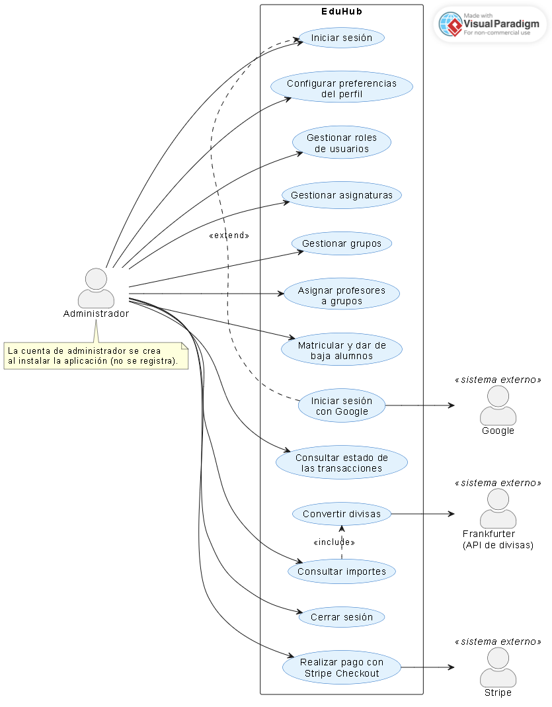
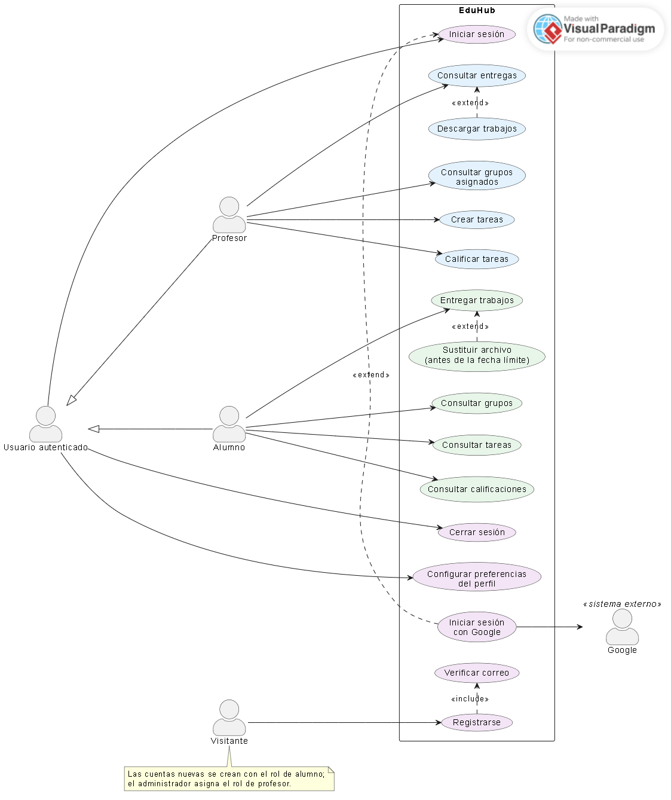
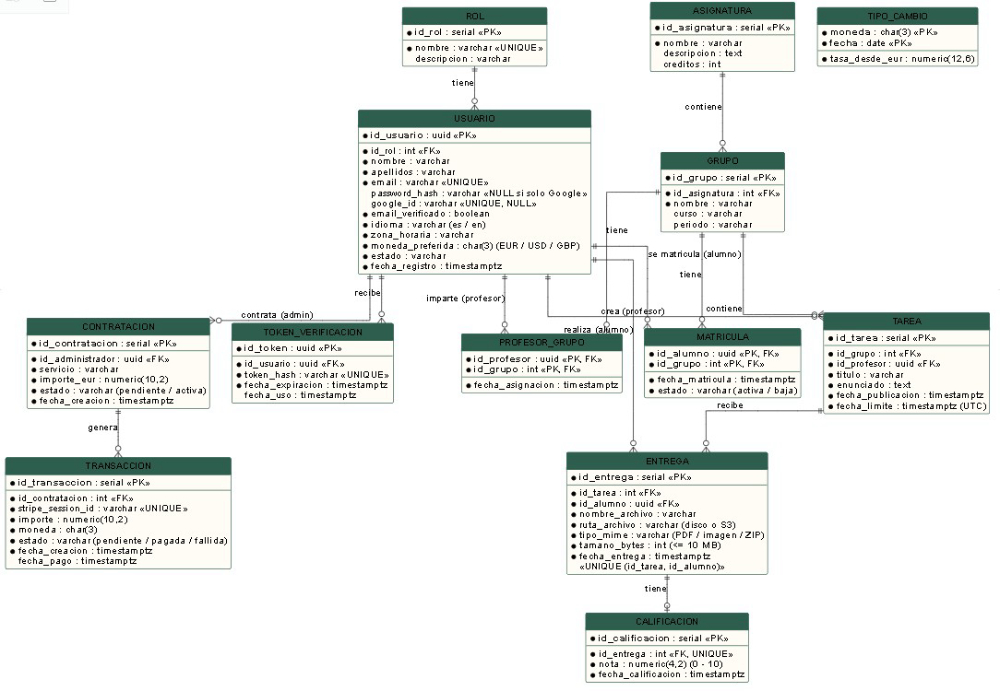
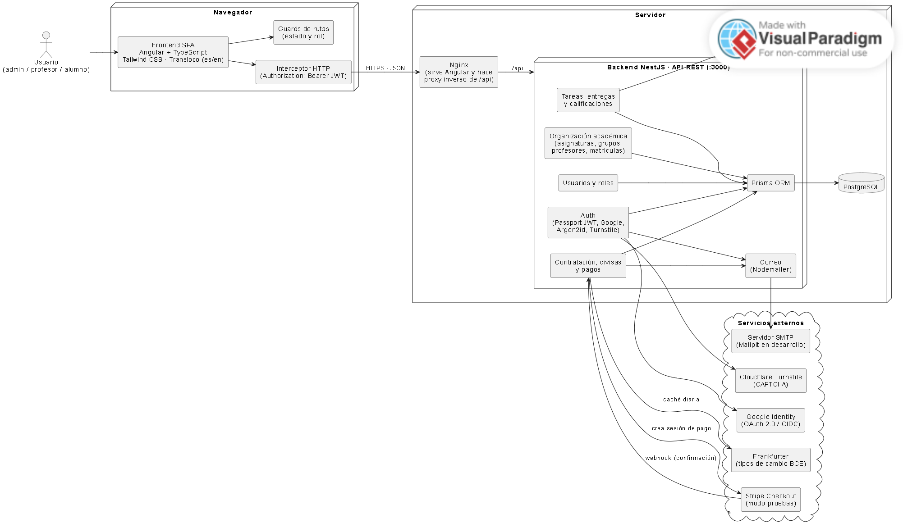
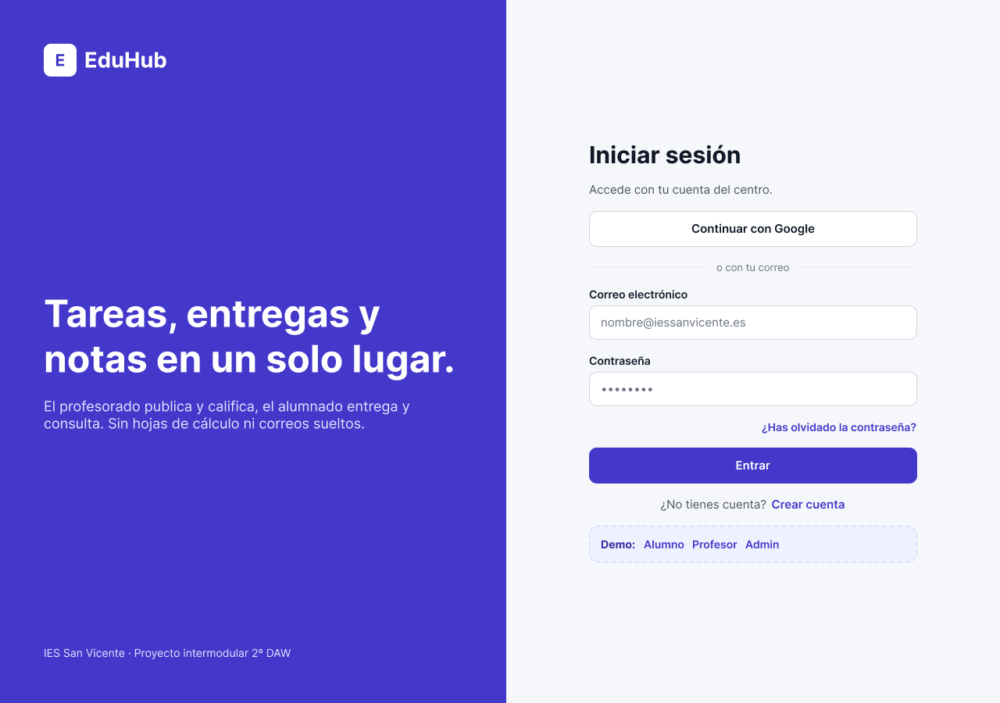
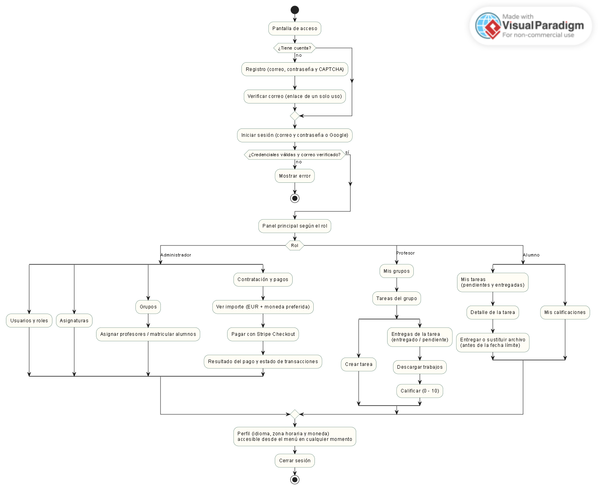

# Primeros apartados
## 1. Introducción

### 1.1. Objetivo del proyecto

El objetivo principal de EduHub es desarrollar una aplicación web que centralice la gestión académica de un centro educativo. La plataforma permitirá administrar asignaturas y grupos, asignar profesores, matricular alumnos y gestionar tareas, entregas y calificaciones, ofreciendo a cada usuario las funcionalidades correspondientes a su rol.

Además, se busca desarrollar una aplicación segura, adaptable a diferentes dispositivos y disponible en español e inglés. El proyecto incluirá la integración de servicios externos, un sistema de contratación y pagos en modo de pruebas y el despliegue de la aplicación en diferentes infraestructuras. También se investigará el uso de la inteligencia artificial, tanto en la plataforma como en el propio desarrollo, y su posible incorporación como funcionalidad opcional.

### 1.2. Justificación del proyecto

En los centros educativos, la gestión de tareas, entregas y calificaciones puede requerir el uso de diferentes herramientas digitales, lo que dificulta la organización y el seguimiento de las actividades académicas. EduHub surge con la intención de reunir estas funciones en una única plataforma, facilitando al profesorado la gestión de actividades, al alumnado la consulta de tareas y calificaciones y a los administradores la organización de asignaturas y grupos.

Además de su utilidad en el ámbito educativo, el desarrollo de EduHub permitirá aplicar los conocimientos adquiridos durante el ciclo de Desarrollo de Aplicaciones Web. El proyecto abarcará el desarrollo del frontend y del backend, la gestión de bases de datos, la implementación de medidas de seguridad y el despliegue en diferentes infraestructuras, ofreciendo una oportunidad para trabajar de forma conjunta las competencias adquiridas durante el ciclo.

### 1.3. Alcance del proyecto

EduHub comprende el análisis, diseño, desarrollo, pruebas y despliegue de una aplicación web para la gestión académica de un centro educativo. Para organizar el trabajo, las funcionalidades se han dividido en cuatro niveles de prioridad: P1 (obligatorias), P2 (ampliaciones previstas), P3 (ampliaciones futuras) y, como opcional final, la integración de inteligencia artificial.

**Funcionalidades obligatorias (P1)**

La primera versión de EduHub incluirá cuatro módulos principales:

1.  **Gestión de usuarios y seguridad:** registro, verificación de correo, inicio de sesión mediante credenciales o Google y control de acceso según los roles de administrador, profesor y alumno.

2.  **Organización académica:** gestión de asignaturas y grupos, asignación de profesores y matriculación de alumnos.

3.  **Tareas, entregas y calificaciones:** publicación de actividades, entrega de archivos, seguimiento de trabajos y evaluación del alumnado.

4.  **Contratación y pagos:** integración de Stripe en modo de pruebas, consulta de tipos de cambio mediante una API externa y envío de confirmaciones por correo electrónico.

La aplicación se desarrollará utilizando Angular, NestJS y PostgreSQL, contará con una interfaz adaptable a diferentes dispositivos y estará disponible en español e inglés. El P1 incluye también las medidas de seguridad, las pruebas unitarias y de integración, la documentación de análisis y diseño, el manual de usuario, el manual técnico de despliegue, las medidas de sostenibilidad (ODS 9, 12 y 13) y una investigación sobre el uso de la inteligencia artificial en la plataforma y en el desarrollo.

Además, la aplicación se desplegará en cinco entornos con la misma base de código: un VPS con Docker Compose y Nginx sobre AWS EC2, un VPS con Apache y Passenger, un despliegue híbrido (servidor local con S3 y CloudFront), un despliegue PaaS con escalado dinámico y CI/CD (Elastic Beanstalk y GitHub Actions) y un despliegue serverless (AWS Lambda, API Gateway y Aurora Serverless v2) con estimación de costes. Con los datos de estos despliegues se comparará la nube pública con un despliegue local y con un VPS en OVH.

**Ampliaciones previstas (P2)**

Una vez completada la primera versión, se podrán incorporar funcionalidades como la recuperación de contraseñas, la gestión avanzada de usuarios, los calendarios de entregas, las notificaciones automáticas, los exámenes online y las mejoras del sistema de pagos.

**Ampliaciones futuras (P3)**

Se contempla la posibilidad de ampliar EduHub para gestionar varios centros educativos, incorporar una biblioteca digital, permitir el acceso de las familias y añadir herramientas de gestión económica y de personal.

**Opcional final: inteligencia artificial**

Es lo último que se abordará, después del P2 y de las ampliaciones P3 que se decida hacer: un generador de borradores de actividades para el profesorado y un asistente de dudas para el alumnado. Si no da tiempo, no se implementa y el proyecto sigue completo. La investigación sobre IA, en cambio, forma parte del P1.

**Limitaciones y criterio de cierre**

La primera versión estará destinada a un único centro educativo y funcionará exclusivamente como aplicación web. Los pagos se realizarán en modo de pruebas y se utilizarán datos ficticios para comprobar el funcionamiento del sistema. Quedan fuera del proyecto los cobros reales, el entrenamiento de modelos de IA propios, una aplicación móvil nativa y el uso de Kubernetes.

El proyecto se considerará completo cuando todo el P1, incluidos los cinco despliegues, funcione y esté probado y documentado. Ninguna funcionalidad P1 puede sustituirse por una P2. Las funcionalidades P2, P3 y la integración de inteligencia artificial no son necesarias para el cierre.

### 1.4. Público objetivo

EduHub está dirigida a centros educativos que buscan centralizar la organización de sus actividades académicas. En su primera versión, la aplicación estará diseñada para un único centro y contará con tres tipos de usuarios:

- **Administradores:** encargados de gestionar las asignaturas y los grupos, asignar el profesorado, matricular al alumnado y cambiar el rol de los usuarios, así como de acceder al módulo de contratación y pagos.

- **Profesores:** responsables de publicar tareas, establecer fechas de entrega, revisar los trabajos del alumnado y asignar calificaciones.

- **Alumnos:** podrán consultar sus asignaturas y actividades, entregar trabajos y acceder a las calificaciones obtenidas.

La cuenta de administrador se crea al instalar la aplicación. Las cuentas nuevas se crean siempre con el rol de alumno, y es el administrador quien asigna el rol de profesor.

Cada usuario dispondrá de funcionalidades y permisos adaptados a su rol, facilitando el acceso a la información necesaria para realizar sus tareas dentro de la plataforma.

## 2. Antecedentes

### 2.1. Estado del arte

Actualmente, existen diferentes plataformas digitales que facilitan la gestión de actividades académicas, la entrega de trabajos y el seguimiento del alumnado. Entre las más conocidas se encuentran Moodle [1], Google Classroom [2] y Microsoft Teams para Educación [3].

**Moodle** es una plataforma de gestión del aprendizaje (LMS) de código abierto que permite administrar cursos, publicar materiales, gestionar entregas y evaluar actividades. Destaca por sus posibilidades de personalización, aunque su configuración y mantenimiento pueden requerir conocimientos técnicos.

**Google Classroom** permite organizar clases, publicar tareas, establecer fechas de entrega y asignar calificaciones. Su principal ventaja es la sencillez de uso y su integración con herramientas como Google Drive y Documentos, aunque determinadas funciones de administración académica requieren soluciones complementarias.

**Microsoft Teams para Educación** combina la gestión de actividades académicas con herramientas de comunicación y colaboración. Permite compartir materiales, realizar reuniones virtuales y evaluar tareas, destacando por su integración con Microsoft 365.

**Tecnologías existentes**

Las aplicaciones web actuales suelen separar un frontend de tipo SPA (aplicación de una sola página), que se ejecuta en el navegador, de un backend que expone una API REST. Entre los frameworks de frontend más conocidos están Angular [4], React [5] y Vue [6]. En el backend con Node.js destacan Express [7], un framework minimalista, y NestJS [8], que añade una estructura modular, inyección de dependencias y TypeScript. Para el acceso a datos se usan ORM como Prisma [9], y para la autenticación, tokens JWT y protocolos estándar como OAuth 2.0 y OpenID Connect, que permiten iniciar sesión con cuentas externas como las de Google.

EduHub utiliza Angular, como exigen los requisitos del proyecto, y NestJS con Prisma en el backend, porque comparten TypeScript con el frontend y ofrecen una estructura modular adecuada para dividir el trabajo entre seis personas.

**Tendencias actuales**

- **IA generativa en las plataformas educativas.** Moodle incorpora desde la versión 4.5 un subsistema de IA que conecta con proveedores externos de modelos de lenguaje [10], y Google ofrece desde 2025, sin coste para los centros con Google Workspace for Education, un conjunto de herramientas de IA para el profesorado dentro de Classroom [11]. La UNESCO publicó en 2023 la primera guía mundial sobre IA generativa en la educación y la investigación, que defiende un uso centrado en las personas y con salvaguardas [12]. En la Unión Europea, el Reglamento de Inteligencia Artificial considera de alto riesgo, entre otros, los sistemas de IA que evalúan los resultados de aprendizaje o vigilan exámenes [13]. Por eso, la IA opcional de EduHub (borradores de actividades que el profesorado revisa y un asistente de dudas para el alumnado) no interviene en la calificación.
- **Protección de datos en las plataformas educativas.** Las autoridades españolas de protección de datos publicaron en marzo de 2026 un decálogo para la contratación y el uso de plataformas educativas digitales, que recuerda que su uso no es voluntario para el alumnado y que tratan datos de menores [14]. La AEPD mantiene además una guía específica para centros educativos [15].
- **Despliegue en contenedores y en la nube.** Es habitual empaquetar estas aplicaciones en contenedores (Docker) y desplegarlas en servicios en la nube de distintos tipos: máquinas virtuales (IaaS), plataformas gestionadas con escalado automático (PaaS) y funciones sin servidor (serverless). EduHub probará estos modelos en sus cinco despliegues.

**Relación con EduHub**

EduHub comparte con estas plataformas funcionalidades como la gestión de tareas, entregas y calificaciones, pero se centra en desarrollar una solución más reducida, orientada inicialmente a un único centro educativo. Además de las funciones académicas, el proyecto contempla la integración de servicios externos y el despliegue de la aplicación en diferentes infraestructuras, permitiendo aplicar y evaluar distintas tecnologías durante su desarrollo.

**Referencias**

1. Moodle. https://moodle.org
2. Google for Education. Google Classroom. https://edu.google.com/workspace-for-education/classroom/
3. Microsoft. Microsoft Teams para Educación. https://www.microsoft.com/es-es/education/products/teams
4. Angular. https://angular.dev
5. React. https://react.dev
6. Vue.js. https://vuejs.org
7. Express. https://expressjs.com
8. NestJS. https://nestjs.com
9. Prisma. https://www.prisma.io
10. Moodle Docs. AI subsystem (Moodle 4.5). https://docs.moodle.org/405/en/AI_subsystem
11. Google (2025). Gemini in Classroom: No-cost AI tools that amplify teaching and learning. https://blog.google/outreach-initiatives/education/classroom-ai-features
12. UNESCO (2023). Guidance for generative AI in education and research. https://unesdoc.unesco.org/ark:/48223/pf0000386693
13. Reglamento (UE) 2024/1689, de Inteligencia Artificial, anexo III, punto 3. https://eur-lex.europa.eu/eli/reg/2024/1689/oj
14. AEPD, APDCAT, AVPD y CTPDA (2026). Principios básicos para la contratación y uso de plataformas educativas digitales por las administraciones educativas y centros docentes. https://www.aepd.es/documento/apd-plataformas-educativas-administraciones-centros.pdf
15. AEPD. Guía para centros educativos. https://www.aepd.es/guias/guia-centros-educativos.pdf

### 2.2. Problemática identificada

En muchos centros, el trabajo diario del aula se reparte entre varias herramientas: una para publicar tareas, otra para recoger las entregas, hojas de cálculo para las notas y el correo para avisar al alumnado. Esta dispersión provoca problemas concretos:

- Es difícil saber de un vistazo qué alumnos han entregado una tarea y cuáles no.
- Las calificaciones quedan repartidas en hojas de cálculo del profesorado, sin un lugar común donde el alumnado pueda consultarlas.
- Los plazos de entrega no se controlan de forma automática.
- Los datos del alumnado, a menudo menor de edad, acaban almacenados en servicios distintos, lo que complica cumplir la normativa de protección de datos.

Las plataformas consolidadas resuelven parte de estos problemas, pero son soluciones de carácter general: Moodle requiere conocimientos técnicos para configurarse y mantenerse, y Classroom y Teams están ligados al ecosistema de su proveedor (Google Workspace for Education y Microsoft 365). Para un centro que solo necesita organizar asignaturas y grupos y gestionar el ciclo completo de una tarea, puede resultar más adecuada una herramienta más acotada, con roles y permisos ajustados a administradores, profesores y alumnos.

### 2.3. Motivación

Como alumnado de 2º de DAW en modalidad semipresencial, buena parte de nuestro trabajo se publica, se entrega y se califica a través de un aula virtual. Conocemos ese flujo de primera mano desde el lado del alumnado, y eso nos ha llevado a plantearnos cómo sería una herramienta centrada solo en él, sencilla de usar tanto para el profesorado como para el alumnado.

Asimismo, el proyecto nos permitirá explorar la integración de diferentes servicios externos y alternativas de despliegue, así como trabajar con tecnologías actuales como Angular, NestJS y PostgreSQL. Esto nos permitirá abordar el desarrollo de una solución completa y estudiar distintas posibilidades tecnológicas para su implementación.

## 3. Análisis

### 3.1. Requisitos funcionales

Los requisitos funcionales describen las operaciones que debe permitir realizar EduHub. Se han organizado en cuatro módulos, correspondientes a las funcionalidades obligatorias (P1) del proyecto.

**Módulo 1. Gestión de usuarios y seguridad**

| **ID** | **Requisito**            | **Descripción**                                                                                                                                                                                          | **Prioridad** |
|--------|--------------------------|----------------------------------------------------------------------------------------------------------------------------------------------------------------------------------------------------------|---------------|
| RF01   | Registro de usuarios     | Permitir a un visitante registrarse mediante correo electrónico y contraseña, protegido con CAPTCHA. Toda cuenta nueva, también la creada al entrar por primera vez con Google, recibe el rol de alumno. | P1            |
| RF02   | Verificación de cuenta   | Verificar el correo electrónico mediante un enlace de un solo uso antes de permitir el acceso.                                                                                                           | P1            |
| RF03   | Inicio de sesión         | Permitir el acceso mediante correo y contraseña o una cuenta de Google.                                                                                                                                  | P1            |
| RF04   | Cierre de sesión         | Permitir cerrar la sesión del usuario.                                                                                                                                                                   | P1            |
| RF05   | Gestión de roles         | Permitir al administrador cambiar el rol de un usuario entre alumno y profesor sin eliminar su cuenta. La cuenta de administrador se crea al instalar la aplicación.                                     | P1            |
| RF06   | Control de acceso        | Restringir las funcionalidades según el estado de autenticación y el rol del usuario.                                                                                                                    | P1            |
| RF07   | Configuración del perfil | Permitir configurar el idioma, la zona horaria y la moneda preferida.                                                                                                                                    | P1            |

**Módulo 2. Organización académica**

| **ID** | **Requisito**            | **Descripción**                                                                                   | **Prioridad** |
|--------|--------------------------|---------------------------------------------------------------------------------------------------|---------------|
| RF08   | Gestión de asignaturas   | Permitir al administrador crear, modificar y eliminar asignaturas.                                | P1            |
| RF09   | Gestión de grupos        | Permitir al administrador crear, modificar y eliminar grupos, cada uno asociado a una asignatura. | P1            |
| RF10   | Asignación de profesores | Permitir al administrador asignar uno o varios profesores a un grupo y retirarlos.                | P1            |
| RF11   | Matriculación de alumnos | Permitir al administrador matricular alumnos en los grupos y darlos de baja.                      | P1            |
| RF12   | Consulta de grupos       | Permitir a profesores y alumnos consultar únicamente los grupos que tienen asignados.             | P1            |

**Módulo 3. Tareas, entregas y calificaciones**

| **ID** | **Requisito**              | **Descripción**                                                                                               | **Prioridad** |
|--------|----------------------------|---------------------------------------------------------------------------------------------------------------|---------------|
| RF13   | Creación de tareas         | Permitir al profesor publicar tareas en los grupos que tiene asignados, con título, enunciado y fecha límite. | P1            |
| RF14   | Consulta de tareas         | Permitir al alumnado consultar las tareas de sus grupos.                                                      | P1            |
| RF15   | Entrega de trabajos        | Permitir al alumno entregar un archivo (PDF, imagen o ZIP, de hasta 10 MB) antes de la fecha límite.          | P1            |
| RF16   | Modificación de entregas   | Permitir al alumno sustituir el archivo entregado mientras no venza la fecha límite.                          | P1            |
| RF17   | Seguimiento de entregas    | Permitir al profesor consultar qué alumnos han entregado y cuáles tienen tareas pendientes.                   | P1            |
| RF18   | Descarga de trabajos       | Permitir al profesor descargar los archivos entregados por sus alumnos.                                       | P1            |
| RF19   | Calificación de tareas     | Permitir al profesor asignar calificaciones numéricas entre 0 y 10.                                           | P1            |
| RF20   | Consulta de calificaciones | Permitir al alumnado consultar las notas obtenidas y el estado de sus tareas.                                 | P1            |

**Módulo 4. Contratación, divisas y pagos**

| **ID** | **Requisito**             | **Descripción**                                                                                                                                 | **Prioridad** |
|--------|---------------------------|-------------------------------------------------------------------------------------------------------------------------------------------------|---------------|
| RF21   | Consulta de importes      | Mostrar el importe del servicio contratable en euros. **[PENDIENTE: definir qué se contrata, por ejemplo una licencia anual con precio fijo.]** | P1            |
| RF22   | Conversión de divisas     | Consultar la API externa Frankfurter para mostrar el importe equivalente en la moneda preferida del usuario (USD o GBP).                        | P1            |
| RF23   | Procesamiento de pagos    | Permitir al administrador realizar pagos mediante Stripe Checkout en modo de pruebas.                                                           | P1            |
| RF24   | Registro de transacciones | Registrar el estado de las operaciones y actualizar el estado de contratación tras la confirmación del pago.                                    | P1            |
| RF25   | Confirmación por correo   | Enviar automáticamente un correo con el resumen del pago procesado.                                                                             | P1            |

**Requisitos funcionales transversales**

| **ID** | **Requisito**       | **Descripción**                                                              | **Prioridad** |
|--------|---------------------|------------------------------------------------------------------------------|---------------|
| RF26   | Cambio de idioma    | Permitir utilizar la aplicación en español e inglés.                         | P1            |
| RF27   | Adaptación regional | Mostrar fechas, horas, números y monedas según las preferencias del usuario. | P1            |

### 3.2. Requisitos no funcionales

| **ID** | **Categoría**        | **Requisito**                  | **Descripción**                                                                                                                                                                                                                                                                                                                                                          | **Prioridad** |
|--------|----------------------|--------------------------------|--------------------------------------------------------------------------------------------------------------------------------------------------------------------------------------------------------------------------------------------------------------------------------------------------------------------------------------------------------------------------|---------------|
| RNF01  | Seguridad            | Protección de contraseñas      | Almacenar las contraseñas mediante el algoritmo Argon2id.                                                                                                                                                                                                                                                                                                                | P1            |
| RNF02  | Seguridad            | Autenticación segura           | Utilizar tokens JWT con tiempo de expiración y controles de acceso en frontend y backend.                                                                                                                                                                                                                                                                                | P1            |
| RNF03  | Seguridad            | Protección de datos            | Servir la aplicación solo por HTTPS, validar todas las entradas en el backend, verificar en el servidor el CAPTCHA y la firma de los webhooks de Stripe, comprobar en cada petición que el usuario tiene acceso al grupo o la tarea que solicita, validar el tipo y el tamaño de los archivos subidos y guardar las claves de los servicios externos solo en el backend. | P1            |
| RNF04  | Usabilidad           | Diseño responsive              | Adaptar la interfaz a ordenadores, tabletas y dispositivos móviles.                                                                                                                                                                                                                                                                                                      | P1            |
| RNF05  | Usabilidad           | Interfaz intuitiva             | Organizar la navegación según el rol del usuario, facilitando el acceso a sus funcionalidades.                                                                                                                                                                                                                                                                           | P1            |
| RNF06  | Internacionalización | Soporte multidioma             | Ofrecer la interfaz en español e inglés y adaptar fechas, horas y monedas.                                                                                                                                                                                                                                                                                               | P1            |
| RNF07  | Compatibilidad       | Navegadores web                | Permitir el uso de la aplicación desde las versiones actuales de Chrome, Firefox, Edge y Safari, en escritorio y en móvil.                                                                                                                                                                                                                                               | P1            |
| RNF08  | Arquitectura         | Separación de componentes      | Desarrollar el frontend con Angular, el backend con NestJS y la base de datos con PostgreSQL.                                                                                                                                                                                                                                                                            | P1            |
| RNF09  | Arquitectura         | Comunicación REST              | Utilizar una API REST para la comunicación entre frontend y backend.                                                                                                                                                                                                                                                                                                     | P1            |
| RNF10  | Despliegue           | Portabilidad                   | Permitir el despliegue de la aplicación en diferentes infraestructuras reutilizando una misma base de código.                                                                                                                                                                                                                                                            | P1            |
| RNF11  | Despliegue           | Reproducibilidad               | Documentar los pasos necesarios para instalar y configurar la aplicación en un servidor VPS.                                                                                                                                                                                                                                                                             | P1            |
| RNF12  | Mantenimiento        | Calidad del código             | Utilizar control de versiones, una estructura modular y buenas prácticas de desarrollo.                                                                                                                                                                                                                                                                                  | P1            |
| RNF13  | Calidad              | Pruebas                        | Realizar pruebas unitarias y de integración para comprobar el funcionamiento de la aplicación.                                                                                                                                                                                                                                                                           | P1            |
| RNF14  | Sostenibilidad       | Uso eficiente de recursos      | Aplicar medidas de optimización relacionadas con los ODS 9, 12 y 13.                                                                                                                                                                                                                                                                                                     | P1            |
| RNF15  | Rendimiento          | Carga eficiente                | Cargar las rutas de Angular de forma diferida, comprimir las respuestas en Nginx, usar índices en las consultas frecuentes y guardar en caché durante un día los tipos de cambio para no repetir peticiones a la API externa.                                                                                                                                            | P1            |
| RNF16  | Escalabilidad        | Backend sin estado             | Mantener el backend sin estado de sesión (JWT) y el almacenamiento de archivos intercambiable entre disco local y S3, para poder ejecutar varias instancias (de 1 a 3 en el despliegue PaaS).                                                                                                                                                                            | P1            |
| RNF17  | Privacidad           | Protección de datos personales | Cumplir el RGPD y la LOPDGDD: recoger solo los datos personales necesarios, trabajar únicamente con datos ficticios durante el desarrollo y las pruebas y tener en cuenta que parte del alumnado puede ser menor de edad.                                                                                                                                                | P1            |

### 3.3. Casos de uso

**Casos de uso del administrador**

El administrador se encarga de la organización académica de la plataforma. Puede cambiar el rol de los usuarios, gestionar asignaturas y grupos, asignar profesores, matricular alumnos y realizar operaciones relacionadas con la contratación y los pagos.

**Figura 1. Casos de uso del administrador.**

**Casos de uso del profesor y del alumno**

El profesor puede consultar sus grupos, crear tareas, revisar las entregas y asignar calificaciones. Por su parte, el alumno puede consultar las tareas de sus grupos, entregar o sustituir trabajos antes de la fecha límite y consultar sus notas.

Ambos perfiles comparten las funcionalidades de cualquier usuario autenticado: iniciar y cerrar sesión y configurar sus preferencias personales. El registro y la verificación del correo no los realiza ninguno de estos roles, sino un visitante (usuario no registrado), cuya cuenta se crea con el rol de alumno.

**[PENDIENTE: añadir el actor Visitante (registro y verificación del correo) en la Figura 2 o en una figura aparte.]**

**Figura 2. Casos de uso del profesor y del alumno.**

### 3.4. Descripción de actores

En EduHub se identifican cuatro actores: el visitante, que todavía no tiene cuenta, y tres tipos de usuarios con funciones y permisos específicos dentro de la plataforma.

| **Actor**         | **Descripción**                                                                                                | **Funciones principales**                                                                                                                             |
|-------------------|----------------------------------------------------------------------------------------------------------------|-------------------------------------------------------------------------------------------------------------------------------------------------------|
| **Visitante**     | Persona que todavía no tiene cuenta en la plataforma.                                                          | Registrarse con correo y contraseña (con CAPTCHA) o entrar por primera vez con Google, y verificar su correo. Su cuenta se crea con el rol de alumno. |
| **Administrador** | Responsable de la configuración y organización académica de la plataforma.                                     | Cambiar el rol de los usuarios, gestionar asignaturas y grupos, asignar profesores, matricular alumnos y gestionar los pagos.                         |
| **Profesor**      | Usuario encargado de gestionar las actividades académicas de los grupos que tiene asignados.                   | Crear tareas, consultar y descargar entregas, realizar el seguimiento del alumnado y asignar calificaciones.                                          |
| **Alumno**        | Usuario matriculado en uno o varios grupos que utiliza la plataforma para realizar sus actividades académicas. | Consultar tareas, entregar trabajos, sustituir archivos antes de la fecha límite y consultar calificaciones.                                          |

Administrador, profesor y alumno pueden iniciar y cerrar sesión, configurar sus preferencias personales y acceder únicamente a las funcionalidades correspondientes a su rol.

## 4. Diseño

En este apartado se describe la estructura técnica de EduHub, incluyendo la organización de la base de datos, la arquitectura de la aplicación y el diseño de la interfaz.

### 4.1. Modelo de datos (Entidad-Relación)

La base de datos de EduHub se diseñará utilizando PostgreSQL y permitirá almacenar y relacionar la información necesaria para el funcionamiento de la plataforma.

El siguiente diagrama entidad-relación representa las principales entidades del sistema, sus atributos, claves primarias y foráneas, así como las relaciones y cardinalidades existentes entre ellas.

**Figura 3. Diagrama entidad-relación de EduHub.**

El modelo contempla la gestión de usuarios y sus roles, la organización de asignaturas y grupos, las matrículas, las tareas y entregas del alumnado, las calificaciones y las operaciones relacionadas con la contratación y los pagos. Las entidades principales y sus relaciones son las siguientes:

**[PENDIENTE: comprobar que estos nombres y relaciones coinciden con la Figura 3.]**

- **Usuario:** datos de acceso (correo y contraseña cifrada con Argon2id, o cuenta de Google), estado de verificación, rol (administrador, profesor o alumno) y preferencias (idioma, zona horaria y moneda).
- **Token de verificación:** enlace de un solo uso asociado a un usuario.
- **Asignatura** y **Grupo:** cada asignatura tiene uno o varios grupos (1:N).
- **Asignación de profesorado:** relación N:M entre profesores y grupos.
- **Matrícula:** relación N:M entre alumnos y grupos.
- **Tarea:** pertenece a un grupo y la crea un profesor; guarda el título, el enunciado y la fecha límite (en UTC).
- **Entrega:** archivo entregado por un alumno para una tarea; como máximo una por alumno y tarea, sustituible hasta la fecha límite.
- **Calificación:** nota de 0 a 10 de un alumno en una tarea. **[PENDIENTE: decidir si se puede calificar a un alumno que no ha entregado; si es así, la nota no puede guardarse solo en la entrega.]**
- **Pago:** transacción iniciada por el administrador, con importe, moneda, estado (pendiente, pagada o fallida) e identificador de la sesión de Stripe; su confirmación actualiza el estado de la contratación.

Esta estructura servirá como base para implementar la base de datos y garantizar la integridad de la información.

### 4.2. Arquitectura del sistema

EduHub seguirá una **arquitectura cliente-servidor en tres capas**, con una separación entre la interfaz de usuario, la lógica de negocio y la base de datos.

La aplicación estará formada por los siguientes componentes:

| **Componente**                 | **Tecnología**                                                                       | **Función**                                                                                                                |
|--------------------------------|--------------------------------------------------------------------------------------|----------------------------------------------------------------------------------------------------------------------------|
| **Frontend**                   | Angular, TypeScript, Tailwind CSS y Transloco                                        | Gestionar la interfaz, la interacción con los usuarios, la navegación según el rol y la traducción al español y al inglés. |
| **Backend**                    | Node.js, NestJS, Passport (JWT y Google OAuth), argon2, class-validator y Prisma ORM | Procesar las solicitudes, gestionar la autenticación y aplicar la lógica de negocio.                                       |
| **Base de datos**              | PostgreSQL                                                                           | Almacenar y gestionar la información de la plataforma.                                                                     |
| **Almacenamiento de archivos** | Disco local o Amazon S3                                                              | Guardar los archivos de las entregas.                                                                                      |
| **Correo**                     | Nodemailer con un proveedor SMTP (Mailpit en desarrollo)                             | Enviar los correos automáticos.                                                                                            |
| **Calidad y despliegue**       | Git y GitHub, GitHub Actions, Jest, Docker y Nginx                                   | Control de versiones, pruebas automáticas, integración continua y despliegue.                                              |

**Frontend.** Las rutas se agrupan por área (acceso, administración, profesorado, alumnado y perfil) y se cargan de forma diferida. Los guards de Angular impiden el acceso a las rutas según el estado de autenticación y el rol, y un interceptor HTTP añade el token JWT a cada petición en la cabecera `Authorization: Bearer <token>`.

**Backend.** Se organiza en capas: los controladores reciben las peticiones de la API REST y validan los datos de entrada, los servicios aplican la lógica de negocio y los permisos, y el acceso a la base de datos se hace mediante Prisma. El código se divide en módulos de NestJS alineados con los módulos funcionales:

| **Módulo de NestJS**   | **Responsabilidad**                                                                                       | **Módulo funcional** |
|------------------------|-----------------------------------------------------------------------------------------------------------|----------------------|
| Autenticación          | Registro con CAPTCHA, verificación del correo, inicio de sesión con contraseña o Google y emisión de JWT. | M1                   |
| Usuarios               | Perfil, preferencias y cambio de rol.                                                                     | M1                   |
| Organización académica | Asignaturas, grupos, asignación de profesorado y matrículas.                                              | M2                   |
| Tareas y entregas      | Tareas, archivos entregados y calificaciones.                                                             | M3                   |
| Pagos                  | Stripe Checkout y webhook de confirmación.                                                                | M4                   |
| Divisas                | Consulta a Frankfurter con caché diaria.                                                                  | M4                   |
| Correo                 | Envío de los correos automáticos.                                                                         | Transversal          |
| Almacenamiento         | Acceso a los archivos en disco local o en S3.                                                             | Transversal          |

La comunicación entre el frontend y el backend se realizará mediante una **API REST**. Además, el backend se integrará con servicios externos como Google OAuth para el inicio de sesión, Cloudflare Turnstile para la protección del registro, Stripe para los pagos, Frankfurter para la conversión de divisas y un servidor SMTP para el envío de correos.

El sistema estará preparado para desplegarse en diferentes entornos, incluyendo servidores VPS, contenedores Docker y plataformas en la nube. En el despliegue principal, Nginx sirve el frontend y actúa como proxy inverso de `/api` hacia el backend.

**Figura 4. Diagrama de arquitectura de EduHub.**

### 4.3. Prototipos de las pantallas

Los prototipos de EduHub permitirán visualizar el diseño inicial de la aplicación antes de comenzar su desarrollo. La interfaz se adaptará al tipo de usuario, ofreciendo diferentes opciones según su rol.

Se han identificado las siguientes pantallas principales:

| **Pantalla**                    | **Descripción**                                                                                               |
|---------------------------------|---------------------------------------------------------------------------------------------------------------|
| **Inicio de sesión y registro** | Permite acceder a la plataforma mediante correo electrónico y contraseña o Google, así como crear una cuenta. |
| **Panel principal**             | Muestra las funcionalidades disponibles según el rol del usuario.                                             |
| **Gestión académica**           | Permite al administrador gestionar asignaturas, grupos, profesores y matrículas.                              |
| **Gestión de tareas**           | Permite al profesor crear actividades, consultar entregas y asignar calificaciones.                           |
| **Mis tareas**                  | Permite al alumno consultar actividades, entregar archivos y visualizar sus notas.                            |
| **Contratación y pagos**        | Muestra los servicios disponibles, sus precios y las opciones de pago.                                        |
| **Perfil de usuario**           | Permite consultar y modificar las preferencias personales, como el idioma y la zona horaria.                  |

Los prototipos seguirán un diseño sencillo, intuitivo y adaptable a distintos dispositivos, facilitando la navegación y el acceso a las funcionalidades principales.

**Figura 5. Prototipos de las principales pantallas de EduHub.**

Prototipo interactivo disponible en: [Figma](https://www.figma.com/design/HE9WGQ9JBtLq9CoE3jzHY8/PROTOTIPO-APLICACION?m=auto&t=qCZRHrYy6TfdSd8q-1)

**[PENDIENTE: sustituir por el enlace del prototipo (`figma.com/proto/...`), que se copia desde la vista de prototipo de Figma, y comprobar que cualquiera con el enlace puede verlo.]**

### 4.4. Flujo de navegación

La navegación de EduHub estará organizada en función de los tres perfiles de usuario: administrador, profesor y alumno.

Tras iniciar sesión, cada usuario accederá a un panel principal adaptado a su rol, desde el que podrá consultar las secciones y funcionalidades correspondientes.

Todos los usuarios podrán acceder a su perfil para modificar sus preferencias personales y cerrar sesión.

La navegación se realizará mediante un menú principal que permitirá cambiar de sección sin necesidad de regresar a la pantalla de inicio.

**Figura 6. Diagrama de flujo de navegación de EduHub.**

